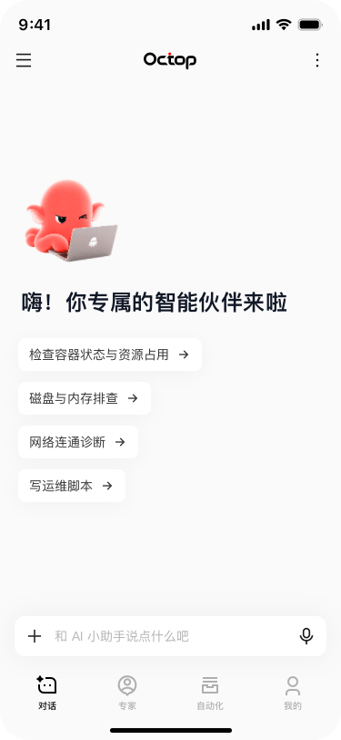

<div align="center">



# OctopBot

**The official mobile client for [Octop](https://github.com/TencentCloud/Octop)** — the self-hosted, multi-user AI assistant platform.

English | [简体中文](README.zh-CN.md)

</div>

---

## Features

- **Streaming chat** — real-time replies over WebSocket with live Markdown rendering (bold, lists, code blocks), tool-call summaries, and a streaming cursor that survives mid-turn markdown.
- **Multi-expert roster** — every agent on your server with its own icon and brand color; start a conversation with any expert in one tap.
- **Conversation history** — threads grouped per expert in the side drawer; open any past conversation and it replays in place.
- **Automation** — cron jobs per expert with instant enable/disable toggles.
- **Native platform feel** — Liquid Glass tab bar on iOS 26+, standard Material navigation on Android, safe-area aware everywhere.
- **Theming** — light/dark modes plus a set of accent palettes; the default follows the design language: pure monochrome ink.
- **Bilingual** — full Chinese and English UI.

## Platform status

| Platform  | Status                                                                                                                         |
| --------- | ------------------------------------------------------------------------------------------------------------------------------ |
| iOS       | ✅ Active development                                                                                                          |
| Android   | ✅ Active development                                                                                                          |
| HarmonyOS | 🔜 Fast-follow on the same JS codebase via [expo-harmony](https://github.com/renbaoshuo/expo-harmony) (community RNOH toolkit) |

## Getting started

Prerequisites: Node 20+, npm, and either Xcode (iOS Simulator) or Android Studio (emulator).

```bash
git clone https://github.com/jubaoliang/OctopBot.git
cd OctopBot
npm install

# Build and run the dev client (first run compiles the native project)
npm run ios        # or: npm run android
```

The app talks to **your own Octop server**: on the login screen enter the server URL (for example `https://octop.example.com`) plus your username and password. Nothing is hardcoded and no credentials are bundled — the base URL and session token live in the device secure store only.

## Scripts

| Command                           | Purpose                       |
| --------------------------------- | ----------------------------- |
| `npm start`                       | Start Metro                   |
| `npm run ios` / `npm run android` | Build + launch the dev client |
| `npm run lint`                    | ESLint (strict, type-checked) |
| `npm run typecheck`               | TypeScript, no emit           |
| `npm test`                        | Jest unit suite               |
| `npm run format`                  | Prettier                      |

## Testing

- **Unit** (`npm test`): parsers, formatters, API clients, chat socket contract — 48+ tests.
- **Integration** (opt-in): a multi-expert, multi-thread scenario that runs the app's own API/WebSocket clients against a real Octop server:

  ```bash
  OCTOP_E2E_URL=https://octop.example.com \
  OCTOP_E2E_USER=alice \
  OCTOP_E2E_PW=secret \
  npx jest integration.scenario
  ```

- **E2E** ([Maestro](https://docs.maestro.dev/)): flows in `.maestro/`, run with `maestro test .maestro/` against the dev client.

## Project structure

```
src/
  app/          # expo-router screens
  components/   # shared UI (tab bar, drawer, markdown bubbles, avatars)
  core/         # pure TypeScript: API clients, chat WebSocket, types
  features/     # auth, app shell
  platform/     # per-platform capability wrappers (glass, secure storage)
  i18n/         # zh / en strings
  theme/        # tokens, palettes, provider
  utils/        # streaming markdown balancer and friends
```

`src/core` contains no `react-native` imports — the business core is portable to any JS runtime, which is also the path for the future HarmonyOS shell.

## Contributing

Conventional Commits, enforced gates (`lint`, `typecheck`, `test` must pass), and one logical change per PR. Interactive commit authoring: `npm run commit`.

## License

[MIT](LICENSE)
