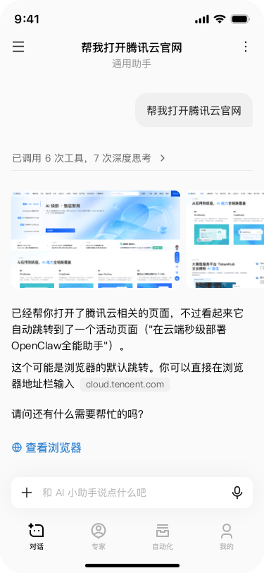
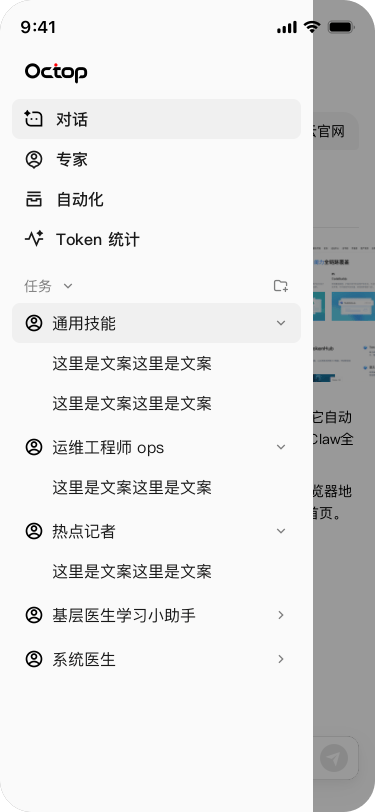

<div align="center">





# OctopBot

**[Octop](https://github.com/TencentCloud/Octop) 官方移动客户端** —— 更聪明的自托管 AI 助手：多用户、多智能体。

[English](README.md) | 简体中文

_预览图为设计稿帧；UI 完成最终打磨后替换为真机截图。_

</div>

---

## ✨ 亮点

- **以对话为核心的伴侣端** —— 连接你自托管的 Octop 服务器，与每一个专家实时流式对话，服务器在哪，对话就在哪。
- **契约先行** —— 应用只使用服务端公开文档化的 HTTP + WebSocket API（版本锁定于 [`docs/api-contract.md`](docs/api-contract.md)）；不抓页面、不碰私有端点。
- **可移植内核** —— 全部业务逻辑（API 客户端、聊天 Socket、状态）为纯 TypeScript，零 `react-native` 导入，随时可扩展到更多平台。
- **纯自托管** —— 无云端后端、无遥测、不内置任何凭据：服务器地址与会话只保存在设备安全存储中。

## 🤔 功能特性

| 领域   | 内容                                                                                          |
| ------ | --------------------------------------------------------------------------------------------- |
| 对话   | WebSocket 实时流式回复，Markdown 实时渲染（代码块、列表、引用），工具调用摘要，生成中途可停止 |
| 专家   | 完整名册，每个专家带图标与品牌色；一键开启对话                                                |
| 历史   | 会话按专家分组收纳于抽屉；打开即原位回放                                                      |
| 自动化 | 按专家管理 cron 任务，开关即时生效                                                            |
| 主题   | 亮/暗模式 + 多套强调色；默认遵循设计语言：纯黑白墨色                                          |
| 平台   | iOS 26+ 液态玻璃标签栏，Android Material 导航，全面适配安全区                                 |
| i18n   | 完整中英文界面                                                                                |

## 🧭 路线图

- ✅ 已交付：流式对话、专家名册、会话历史、cron 自动化、双语界面、主题系统
- 🔨 进行中：消息操作（复制 / 重新生成）、知识库浏览、Release 构建
- 🔜 计划中：推送通知（主动关怀）、专家市场安装、基于 [expo-harmony](https://github.com/renbaoshuo/expo-harmony) 在同一份 JS 代码上支持 HarmonyOS

## 🚀 快速开始

**1. 运行一个 Octop 服务器**（如果还没有）—— 参见 [Octop 快速开始](https://github.com/TencentCloud/Octop#-quick-start)：安装、`octop init`、`octop run`。

**2. 构建并启动应用**（Node 20+，Xcode 或 Android Studio）：

```bash
git clone https://github.com/jubaoliang/OctopBot.git
cd OctopBot
npm install
npm run ios        # 或：npm run android —— 首次运行会编译原生工程
```

**3. 登录** —— 输入服务器地址（例如 `https://octop.example.com`）、用户名与密码。支持局域网 HTTP 服务器（首次有明文提示）；证书校验永不跳过。

## 🏗️ 技术栈

| 层       | 技术                                                                                      |
| -------- | ----------------------------------------------------------------------------------------- |
| 框架     | Expo SDK 58、React Native 0.88、expo-router                                               |
| 语言     | TypeScript 6（strict）、React Compiler                                                    |
| 动效     | Reanimated 4 + worklets、Gesture Handler                                                  |
| 原生能力 | expo-glass-effect（iOS 26 液态玻璃）、expo-blur 回退、expo-secure-store                   |
| 后端契约 | REST + WebSocket，见 [`docs/api-contract.md`](docs/api-contract.md)（服务端 Octop 1.0.x） |
| 测试     | Jest + jest-expo、Maestro E2E                                                             |
| 质量门禁 | ESLint（严格、类型感知）、Prettier、commitlint + Conventional Commits                     |

## 🧪 测试

- **单元测试**（`npm test`）—— 解析器、格式化器、API 客户端、聊天 Socket 握手契约。
- **集成测试**（可选）—— 面向真实服务器的多专家 × 多会话场景，用应用自身的客户端端到端跑通：

  ```bash
  OCTOP_E2E_URL=https://octop.example.com \
  OCTOP_E2E_USER=alice OCTOP_E2E_PW=secret \
  npx jest integration.scenario
  ```

- **端到端**（[Maestro](https://docs.maestro.dev/)）—— 用户旅程用例位于 `.maestro/`：`maestro test .maestro/`。

## 📦 发布构建

商店包通过 [`eas.json`](eas.json) 的 EAS Build 配置（`development` / `preview` / `production`）。签名凭证只放在 EAS 或 CI 密钥中，切勿提交 keystore 或密码。上传 Play 前请确认制品**不是** debug 签名：

```bash
apksigner verify --print-certs path/to/app.apk
# 若证书 CN 为 Android Debug 或别名为 androiddebugkey，则拒绝发布。
```

本地 `expo prebuild` 生成的 `android/` 仍可能把 release 签成 debug；不要分发这类 APK。

## 📁 项目结构

```
src/
  app/          # expo-router 页面
  components/   # 共享 UI（玻璃标签栏、抽屉、Markdown 消息、头像）
  core/         # 纯 TS：API 客户端、聊天 WebSocket、契约类型
  features/     # 认证、应用外壳
  platform/     # 平台能力封装（玻璃效果、安全存储）
  i18n/ theme/  # 中英文案；设计令牌、色板
docs/           # 锁定的 API 契约 + 设计快照
.maestro/       # E2E 用例
```

## 🔒 安全与隐私

应用只是**你的**服务器的瘦客户端：无遥测、无分析、无第三方网络调用。会话令牌与服务器地址保存在操作系统安全存储（Keychain / Keystore）中，请求永不记录凭据，令牌滑动续期全程透明。同样的纪律适用于本仓库：代码、文档与提交中不包含任何密钥、个人数据或机器标识信息。

## 🤝 参与贡献

遵循 Conventional Commits；`lint`、`typecheck`、`test` 三道门禁必须通过；每个 PR 只做一件事。交互式提交：`npm run commit`。服务端功能讨论请加入 [Octop 社区](https://github.com/TencentCloud/Octop#-community)。

## 📄 许可证

[MIT](LICENSE)
